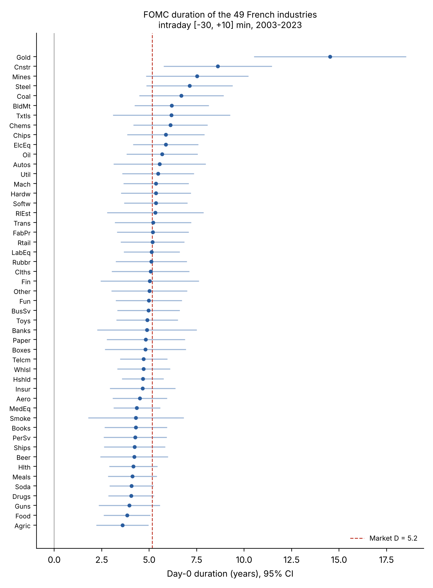
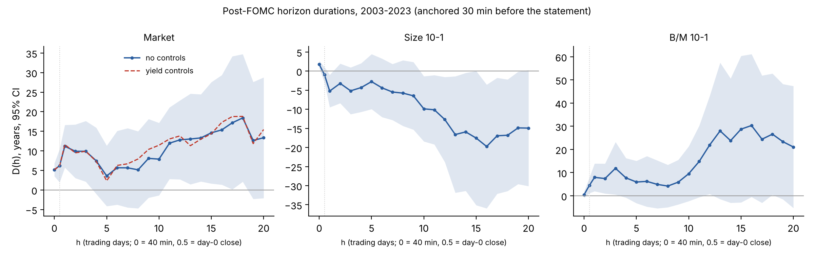

# Post-M4 check-in: what we have learned so far

*Effective Equity Duration and Post-FOMC Drift.* Seth Peterson, Kenzo Ota von Steun,
Grigorios Chatziandreou. November 24, 2026.

This note is written for someone new to the project. It explains the question, what we
built, what we found at each step, how the design changed along the way and why, and
what is still open. Detailed tables live in `results/tables/` and the step-by-step record
lives in [ROADMAP.md](../../ROADMAP.md).

## Bottom line

Stocks keep reacting to a Fed surprise for days after the announcement. In the 40
minutes around the statement, the stock market moves as if it had a duration of about
5 years. Measured from the same starting point, the response reaches about 11 years by
the next day and about 13 years after 20 trading days, so only about a third of the
20-day response happens in the first 40 minutes. The estimate is noisy (the 20-day
figure has a standard error of about 8 years), and the drift is much stronger before
2008 than after.

The more striking results are in the cross-section. Stocks barely differ by value or
growth in the first 40 minutes, but over the following weeks value stocks respond far
more than growth stocks. Large stocks react slightly more at first, and then small
stocks overtake them by a wide margin. In other words, the differences between stocks
that Chen (2022) reads as differences in duration appear mostly *after* the window he
measures. This is the drift we set out to look for, and it is what the strategy
backtest will test next.

## 1. The question

When the Fed surprises the market with a tighter or looser policy than expected, stock
prices move. Zhanhui Chen (2022, *Journal of Financial and Quantitative Analysis*)
turns that move into an **effective equity duration**: the percentage price change per
percentage-point change in discount rates, measured in years, exactly like a bond's
duration. A stock with a duration of 10 falls about 10% when discount rates rise by one
point. Chen measures this in a 40-minute window around each FOMC statement and finds
that stocks behave like very long-duration assets (about 41 years on average), with
duration varying across size and value.

Our question is whether 40 minutes captures the whole response. If investors keep
repricing stocks over the following days, then a same-day measure understates how
sensitive stocks really are to rates, and returns after FOMC meetings should drift in a
predictable direction. We therefore measure duration at horizons from the announcement
itself out to 20 trading days, which we write as D(h). The headline number is the
**same-day share**, D(0)/D(20): the fraction of the 20-day response that is priced
immediately. If that share is well below one, a natural trading strategy follows: after
a surprise, position for the part of the response that has not happened yet.

How we compute it, in one line: for a portfolio, we regress its return over the chosen
horizon on the size of the Fed surprise, across all meetings, and flip the sign. The
surprise is the San Francisco Fed's monetary policy surprise series (MPS, from Bauer
and Swanson), measured in percentage points from interest-rate futures in a tight
window around the statement. A positive surprise means tighter policy than expected.

## 2. Data (M1)

We assembled the data from standard academic sources:

- **Stock returns and characteristics:** CRSP daily stock files and Compustat annual
  accounts through WRDS. From these we build market value, book-to-market, operating
  profitability, leverage and the Fama-French 49 industry classification.
- **Intraday prices:** NYSE TAQ quote data. For each meeting we take the midpoint of the
  best bid and ask for every stock 30 minutes before the statement and 10 minutes after,
  which gives a clean 40-minute return. Our WRDS access covers TAQ from September 2003.
- **Fed surprises:** the San Francisco Fed's MPS series, which currently runs through
  December 2023 (2024 and 2025 will be added when the SF Fed updates its file).
- **Other inputs:** Treasury yields from FRED, Fama-French factors, breakpoints and
  industry definitions from Ken French's site, and Chen's own posted stock-level
  estimates, which we use to check our replication.

The main sample is **162 scheduled FOMC meetings from September 2003 to December
2023**, with a median of about 3,400 stocks per meeting.

## 3. Replicating Chen (M2)

**First attempt, with daily data.** Before we had intraday data, we approximated Chen
with a simpler measure: the regression described above, using each stock's full-day
return on the announcement day, over 1994-2023. This reproduced one of Chen's two main
patterns. Value stocks have longer durations than growth stocks in both his estimates
and ours (our decile ranking correlates 0.66 with his). The other pattern did not
reproduce: Chen finds a U-shape across firm size, with the smallest firms the most
rate-sensitive, while ours was flat.

**Why size differed.** Chen computes a separate duration for every stock at every
meeting, and then throws away any estimate outside 1 to 300 years. Small stocks are
much noisier, so their individual estimates scatter widely, and about 40% of all
estimates are negative. Dropping everything below 1 and above 300 therefore keeps a
selected set of large positive numbers, and it does so far more for small stocks: his
file covers only 19% of the smallest stocks in our universe against 62% of the largest.
When we applied his rule to our own estimates, our flat size profile turned into his
falling one. Much of his high small-stock duration, and much of his overall level of
about 41 years, comes from this trimming rather than from the stocks themselves.

**Exact replication.** We then rebuilt Chen's method step by step: his meetings, his
surprise measure, his betas, his 40-minute intraday window and his 1-300 trim, and
compared our numbers with his posted estimates stock by stock. Every ingredient lined
up except one. His formula needs the change in the expected market return caused by
the announcement, which he gets from a statistical forecasting model (a VAR) whose
details the paper does not fully pin down. None of the versions we built reproduced his
values. Working backward from his posted estimates, we found that the values his
numbers imply are close to a fixed fraction (0.514) of the market's 40-minute return.
Using that fitted stand-in, we recover 77% of his stock-level estimates and match his
size pattern, at levels somewhat above his. We accepted this as the replication,
clearly labeled as fitted to his output.

**What the replication taught us.** Even with his own method, our stock-by-stock
estimates correlate only 0.36 with his. A single stock's 40-minute return at a single
meeting, divided by a small rate surprise, is mostly noise; averages over many stocks
agree far better than individual numbers. The fitted stand-in also exposes a weakness
in the measure itself: if the expected-return change is just a fixed share of the
market's move, a stock that moves one-for-one with the market gets a duration of about
19 years almost by construction.

**Daily versus intraday.** Once the intraday data arrived, the difference in precision
was large. On the same meetings, the market's duration is 5.2 years with a standard
error of 0.85 using the 40-minute window, against 6.7 with a standard error of 3.1
using full-day returns; the surprise explains 30% of the 40-minute market return but
only 7% of the full-day return. The daily results were also fragile: dropping the five
largest surprises cut the daily market duration from 4.7 to 1.5, and the daily value
spread came entirely from after 2008.

## 4. How the design changed, and why

Three decisions came out of the replication.

1. **Replicate Chen exactly, and criticize him separately.** The replication uses his
   method as published (with the fitted stand-in). Our critiques, that the trim selects
   on noise and that the measure is close to mechanical for market-like stocks, go into
   the extension, together with our own untrimmed measure.
2. **Estimate on portfolios, not individual stocks.** Because stock-level estimates are
   mostly noise, from here on we estimate durations for portfolios that average the
   noise away: the 49 Fama-French industries, and decile portfolios sorted on size,
   book-to-market, profitability and leverage. Each is value-weighted, with weights set
   at the end of the previous month.
3. **Use the intraday window and start in 2003.** The 40-minute measure is so much
   sharper than the daily one that we dropped the daily measure and the 1994-2003
   meetings it required. Every result is also reported on a standard robustness set:
   all meetings, without the five largest surprises, without 2008-09 and 2020, and
   separately for 2003-2007 and 2008-2023.

Our untrimmed measure gives much lower levels than Chen's (about 5 years for the market
against his 41). That is expected: we keep the negative and small estimates his rule
drops, and we estimate on portfolios rather than averaging trimmed stock-level ratios.

## 5. The announcement-day response across stocks (M3)

**The market.** The 40-minute market duration is 5.2 years (standard error 0.8), and it
stays between 4.9 and 5.9 across the robustness set. This number is solid.

**Industries differ, and the differences are real.** Industry durations range from
about 3.6 years (agriculture, food) to 14.5 (gold). To check that this spread is not
just noise, we estimated every industry separately on odd and even meetings: the two
rankings correlate 0.65, which implies a reliability of 0.79 for the full sample, and a
permutation test firmly rejects the idea that all industries share one duration, in
every robustness sample. About two-thirds of the spread across industries is signal.

What the ranking looks like is informative. At the top are gold, construction, mining,
steel and coal; at the bottom are food, drugs, soft drinks, restaurants and agriculture.
The top is commodities and cyclical industries, not the long-dated growth firms that
textbook "cash-flow duration" would put there. So the immediate FOMC response seems to
capture exposure to real rates, the dollar and the growth outlook at least as much as
the timing of cash flows. One time pattern stands out: banks and other financial firms
went from about 8.7 years before 2008 to about 3.3 after.

**Characteristics barely matter in the first 40 minutes.** Sorting stocks into deciles
by book-to-market, profitability or leverage produces no spread in the announcement
response (largest-minus-smallest differences of 0.4, -0.2 and -0.3 years, none
significant). Size is the exception: the largest firms respond about 1.8 years more
than the smallest (standard error 0.5), consistently across samples. The smallest
decile stands out at 3.4 years against about 5 for the rest, which suggests small
stocks simply have not finished reacting within ten minutes of the statement.

## 6. After the announcement: duration by horizon (M4)

**Measurement.** Every horizon starts from the same price, the quote midpoint 30
minutes before the statement, so all horizons are comparable and nested: h = 0 is the
40-minute response, then the close of the announcement day, then the close of each of
the next 20 trading days. We estimate each horizon with and without controls for later
moves in 2- and 10-year Treasury yields, so that a stock drift that only mirrors a bond
drift is not mistaken for slow stock pricing. For the long-short portfolios we also
control for the Fama-French five factors and momentum.

**The market keeps moving.** Duration is 5.2 at 40 minutes, 6.2 at the close, 11.2 by
the next day (standard error 2.8), and 13.3 after 20 days (standard error 7.9). The
same-day share is 0.39, or 0.33 with yield controls, so roughly a third of the 20-day
response is priced in the first 40 minutes. The confidence interval is wide (0.16 to
1.32 with yield controls), because the 20-day estimate is noisy. Two further points
matter for interpretation:

- The drift is concentrated in 2003-2007 (20-day duration 22.5, standard error 7.5) and
  weak after 2008 (9.2, standard error 10.3). Dropping the largest surprises or the
  crisis years does not remove it (18 to 22 years at 20 days).
- Treasury yields also keep moving after a surprise: the 2-year yield moves 0.72 points
  per point of surprise on the day and about 1.0 by day 20, and the 10-year goes from
  0.38 to about 1.2. Controlling for those later yield moves does not shrink the stock
  drift (20-day duration 15.4 with controls), so stocks are not simply following bonds.

**Value versus growth: almost all of it is drift.** The value-minus-growth difference is
0.4 years at 40 minutes, 4.4 at the close and about 21 after 20 days (standard error
13; 21.8 with standard error 7.4 after factor controls). The value spread that Chen
attributes to duration is therefore built almost entirely after his window closes. Two
cautions: without controls the 20-day number is not statistically significant and it
falls to 6 when 2008-09 and 2020 are excluded; and the factor-controlled version
includes the value factor itself over the same days, which may respond to the surprise
and absorb part of what we are trying to measure.

**Size: small stocks react late, then more.** Large firms respond 1.8 years more than
small ones in the first 40 minutes. That reverses by the close, and by day 20 small
stocks have responded about 15 years more than large ones (standard error 7.8; about 10,
standard error 4.2, with factor controls). This fits the 40-minute evidence that small
stocks are slow to react, and goes beyond it: their eventual response is larger.

**Industries.** Industry rankings carry over from 40 minutes to the close almost
unchanged (correlation 0.93) and partly to day 20 (0.58). But individual 20-day
industry estimates are too noisy to rank industries on their own (typical standard
error about 11 years), so the 20-day cross-section needs the pooling and sorting
planned for M3 step 2.

## 7. What we take from this so far

1. A same-day measure understates the market's rate sensitivity. Most of the 20-day
   response arrives after the 40-minute window, though how much is uncertain.
2. The cross-sectional pattern Chen reports (value longer than growth, small stocks
   distinctive) is weak or absent within his 40-minute window when measured without his
   trimming, and appears strongly in the days and weeks that follow. This is the most
   interesting result so far and the one the strategy will test.
3. The immediate response sorts industries by commodity and cyclical exposure more than
   by cash-flow timing, which is worth a section of its own.
4. Results rest on a modest number of meetings and are stronger before 2008. Every
   number needs to be read alongside its robustness set.

## 8. Open caveats

- **Noise at long horizons.** Standard errors at 20 days are 5 to 15 years for most
  estimates. Several headline numbers are suggestive rather than conclusive.
- **Few events, uneven periods.** Only 35 of the 162 meetings fall in 2003-2007, where
  much of the market drift comes from. The near-zero-rate years after 2008 produce small
  surprises and weak results.
- **Press conferences.** Since 2011 the Chair's press conference starts about 30 minutes
  after the statement, outside our 40-minute window. Part of what we call drift on day 0
  may be news from the press conference; a longer window is planned as a variant.
- **Fitted replication input.** Our exact replication of Chen relies on an
  expected-return input fitted to his output rather than derived from his model. Asking
  him for the specification remains an option.
- **Factor controls may over-control.** The value and size factors over the holding
  window may themselves respond to the surprise.
- **Fed information effects.** Some surprises may reveal the Fed's view of the economy
  rather than a pure policy shock. The orthogonalized surprise series is a planned
  robustness check.
- **Sample end.** The surprise series stops in December 2023; 2024-25 waits on the SF
  Fed.

## 9. Next steps

- **Finish M3: a duration estimate for every portfolio in real time.** Relate industry
  durations to their lagged characteristics, fit the model at each month end using only
  past meetings, and sort stocks into fitted-duration quintiles. The check is that the
  top-minus-bottom quintile really does separate rate exposure out of sample.
- **Settle the M4 headline.** Decide the headline portfolio (fitted-duration quintiles,
  or value-minus-growth as a first pass) and write up the pre-specified 5- and 20-day
  results.
- **M5: strategy backtest.** After each meeting, go long the high-minus-low duration
  portfolio after an easing surprise and short it after a tightening surprise, hold for
  h days, and measure the Sharpe ratio and the alpha against the Fama-French five factors
  plus momentum, net of trading costs and by subperiod.
- **M6: robustness and the critique of Chen.** Orthogonalized surprises, equal weights,
  microcaps, subsamples, placebo tests on non-FOMC days, a window that includes the
  press conference, and a section showing how the 1-300 trim and the near-mechanical
  market-like duration shape Chen's results, with our untrimmed measure as the
  alternative.
